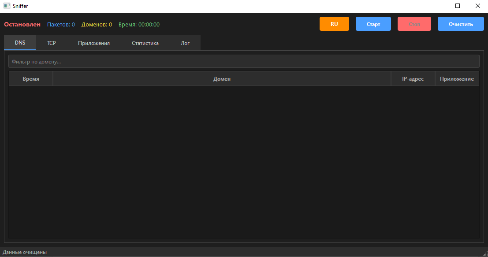

# Sniffer - Анализатор сетевого трафика

- **Перехват DNS-запросов** в реальном времени с отображением доменов, IP-адресов и имени процесса.
- **Мониторинг TCP-соединений** с деталями (порты, объём трафика, время первого появления).
- **Определение приложений**, создающих трафик (Chrome, Telegram, системные процессы и др.).
- **Двуязычный интерфейс**
- **Сортировка данных**
- **Фильтрация DNS-запросов** по домену.
- **Статистика** по протоколам и общий объём трафика.
- **Логирование** всех событий во вкладке «Лог».

---



## Требования

- **Python 3.8+** (если запуск из исходников).
- **Драйвер Npcap** (или WinPcap) - необходим для захвата пакетов.  
  Скачайте и установите [Npcap](https://npcap.com/) с опцией *Install in WinPcap API‑compatible Mode*.
- **Запускать от администратора** - обязательное условие для перехвата трафика.

---

## Running from Source \ Запуск из исходников 

1. Clone the repository or download `Sniffer.py`.
2. Create and activate a virtual environment:
   ```bash
   python -m venv venv
   venv\Scripts\activate
   ```      
3. Install dependencies:
   ```bash
   pip install -r requirements.txt
   ```
   Or manually:
   ```bash
   pip install PySide6 psutil scapy
   ```
4. Run the program as administrator:
   ```bash
   python Sniffer.py
